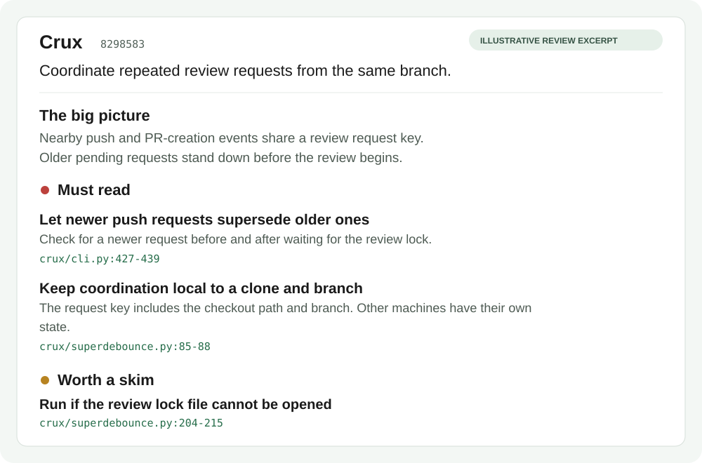

<h1 align="center">Crux</h1>

<p align="center"><strong>Get to the crux of every pull request.</strong></p>
<p align="center">More code is being written. Your time to review it isn't growing with it.</p>

<p align="center">
  <a href="#quick-start"></a>
  <a href="docs/examples/real-pr-review.md"></a>
  <a href="#help-make-crux-better"></a>
</p>

<p align="center">
  <a href="LICENSE">Apache 2.0</a> · Python 3.11+ · <a href="https://sonomos.ai">Sonomos</a>
</p>

**Crux helps reviewers spend their attention where it matters.** It turns a GitHub pull request into a self-updating review card with the big picture, links to the code worth reading closely, and a clearer place to start.

Originally developed internally by **[Jack Rose](https://www.linkedin.com/in/jack-rose-ba1187174), co-founder of [Sonomos](https://sonomos.ai)**, Crux is a tool we use in our own development and code review. We open-sourced it because this problem is bigger than our team.

## AI made writing code faster. Reviewing it is the bottleneck.

AI coding tools can produce substantial changes quickly. A feature that once took days to write can arrive as a large PR with new logic, tests, generated files, cleanup, and dependencies all mixed together. **Someone still has to understand what changed and decide whether it should ship.**

That's harder than just reading more lines.

AI-generated PR summaries help, but they can introduce a different problem: **they don't necessarily allocate explanation in proportion to risk or importance.** A summary can spend paragraphs on straightforward refactoring while giving the one consequential behavior change a sentence. Or it can compress a complicated interaction into a reassuring headline.

Why does that happen?

- **Lost context.** A patch shows edits, not always the surrounding call paths, assumptions, history, or other code that makes an edit important.
- **Uneven attention.** Large or visually obvious diffs can dominate a summary, even when the change with the most impact is only a few lines.
- **Hallucination and false confidence.** A plausible explanation can misstate behavior, infer intent that isn't supported, or miss an important dependency.
- **Fragmented changes.** The real behavior may span files, repositories, or multiple pushes, while a one-off summary describes each piece in isolation.
- **Summary fatigue.** When every PR comes with another wall of prose, the reviewer is still left asking where to begin.

Imagine a PR with hundreds of lines of routine changes and a three-line permission check. A conventional summary might give both equal attention, or describe the larger chunk in greater detail simply because there's more to say. The reviewer could spend twenty minutes verifying the routine code and barely notice the permission change.

**That's the real cost: not just longer reviews, but attention spent on the wrong things.**

Crux exists to address that problem. **It doesn't ask “How do we summarize every line?” It asks “What should a human reviewer understand and inspect first?”**

## A review guide, not another wall of summary text

Crux combines the diff with structural signals, references, history, nearby tests, and configurable sensitivity checks. It then uses Claude Code to produce a **prioritized reading guide**, rather than treating every edit as equally interesting.

| What a reviewer needs | What Crux provides |
| --- | --- |
| Understand the purpose of the PR | **The big picture:** a short explanation of the change and its context |
| Find the consequential changes | **Must read:** linked code locations with reasons to inspect them |
| Triage everything else | **Worth a skim** and a routine-change tally, based on heuristic signals |
| Connect related edits | **Change maps** and surrounding code references where useful |
| Avoid starting over after a push | **One living review card** that can be refreshed in place |
| Review a feature across repositories | **Super PRs** with a combined brief and coordinated landing order |

The point isn't that more words make a review safer. It's that **the right context and the right reading order make a review more useful**. Crux helps you form a hypothesis about where the real risk lives, then gives you links to verify it yourself.

### See what it actually produces

**[Read a real Crux review →](docs/examples/real-pr-review.md)**

On [PR #1](https://github.com/sonomoshq/crux/pull/1), Crux reviewed a small fix for retrying a missing generated headline. It explained the change, drew a change map, highlighted relevant code, and raised a specific concern about the retry path. That concern was a prompt for human investigation, **not a verified defect**.

[](docs/examples/review-card.md)

*The image is an illustrative card rendered with Crux's own renderer and hand-written annotations. The [linked real review](docs/examples/real-pr-review.md) is actual previously published Crux output.*

## Quick start

Start with a local preview. You don't need to install hooks or post anything to GitHub to try Crux.

**1. Install Crux.** Requirements: Python 3.11+, Git, [ripgrep](https://github.com/BurntSushi/ripgrep), `pipx`, and an authenticated [Claude Code CLI](https://docs.anthropic.com/en/docs/claude-code/overview). The [installation reference](docs/reference.md#install) covers alternatives and Windows notes.

```sh
git clone https://github.com/sonomoshq/crux.git
cd crux
pipx install .
pipx ensurepath
```

Open a new terminal and confirm that `crux --help` runs.

**2. Allowlist your repository.** In **the project you want to review**, add or update its `crux.toml`:

```toml
[scope]
owners = ["your-github-org-or-username"]
```

Use the owner from that project's `origin` remote. An empty owner list means Crux won't analyze it. [Configuration details →](docs/reference.md#configure)

**3. Preview a committed change.** From your feature branch:

```sh
crux preview --base main
```

Replace `main` with your target branch. This reads committed changes, not uncommitted edits. Very small changes may return `crux: skipped` because of the configurable review gate. Use `--no-llm` to inspect local triage without invoking Claude.

**4. Publish when ready.** Install and authenticate the GitHub CLI (`gh auth login`), push your branch, then run:

```sh
crux run
```

Crux finds or can offer to create a PR, updates its metadata, and posts or refreshes the review card. Publishing is optional; you can stay with terminal previews. [Full publishing behavior →](docs/reference.md#install)

## Under the hood

1. **Collect context.** Git and ripgrep inspect the committed diff, structural changes, code references, relevant history, and nearby tests.
2. **Triage before calling the model.** A configurable gate can skip AI analysis for changes that meet its routine-change criteria. Signals such as sensitive paths, dependencies, and impact help determine what merits closer inspection.
3. **Produce a focused guide.** Claude Code analyzes selected excerpts and repository context. Crux organizes the result into a brief, reading priorities, and code links.
4. **Refresh the same card.** Later runs update the existing PR review card. Optional integrations extend the workflow to Slack and Zenhub.

**Crux is not a guarantee that a change is safe.** Its priorities and “Safe to skip” labels are heuristic; the model can still miss context or get things wrong. Nothing in a card substitutes for reading the relevant diff, running tests, or human approval. The tool is designed to *direct* judgment, not replace it.

Crux runs on your machine, but **it is not an offline AI model**: selected code excerpts and repository context are passed to your configured Claude Code CLI. Review your organization's data-handling requirements before enabling it. [Data flow and configuration →](docs/reference.md#how-it-works)

## Commands and workflows

| Command | What it's for |
| --- | --- |
| `crux preview` | Inspect a review card locally without publishing |
| `crux run` | Post or update a review card on a GitHub PR |
| `crux prs` | List open PRs across configured repositories |
| `crux super new` | Bring related PRs into one cross-repository review |
| `crux merge` | Review and attempt a merge with the relevant permissions |
| `crux memory` | Manage stored repository facts |
| `crux zenhub` | Link and sync work with Zenhub |
| `crux install-hooks` | Install automated Git and Claude Code hooks |

Prefer to stay in Claude Code? The [plugin](docs/reference.md#claude-code-plugin) provides `/crux:preview` and `/crux:run`. You can also configure [automatic reviews](docs/reference.md#hook-up-git-once-per-machine), [super PRs](docs/reference.md#super-prs-optional), [Slack](docs/reference.md#slack-notifications-optional), and [Zenhub](docs/reference.md#zenhub-optional).

**Before enabling hooks:** commit-message enrichment is on by default and may amend outgoing commits. Set `[commit] enrich = false` before installing hooks to disable it. Automatic delayed review has a [native Windows limitation](docs/reference.md#windows), and some [cloud sessions](docs/reference.md#cloud-sessions) require manual posting.

## Documentation

| Resource | Go here |
| --- | --- |
| Installation, configuration, integrations, troubleshooting | [Full reference](docs/reference.md) |
| Available settings | [Configuration example](crux.toml.example) |
| Implementation and architecture | [DESIGN.md](DESIGN.md) |
| Getting started as a contributor | [CONTRIBUTING.md](CONTRIBUTING.md) |
| A genuine posted review | [Real Crux review](docs/examples/real-pr-review.md) |
| Social assets and launch copy | [Launch kit](docs/launch-kit.md) |

## Help make Crux better

As AI-assisted development keeps accelerating, the challenge isn't writing longer summaries. It's **helping the reviewer notice the changes that actually deserve attention**.

Try Crux on a PR you understand well. Did it surface the part that mattered? Did it overemphasize something routine, or miss a subtle interaction? [Open an issue](https://github.com/sonomoshq/crux/issues/new/choose) or send a focused PR with a public or sanitized example. [Contribution guide →](CONTRIBUTING.md)

Crux is © 2026 Sonomos, Inc., licensed under [Apache 2.0](LICENSE). See [NOTICE](NOTICE).
