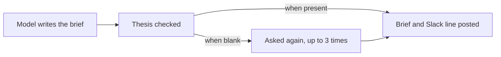

# A real Crux review: a small retry fix

[← Back to Crux](../../README.md#see-the-review-card) · [See the original PR](https://github.com/sonomoshq/crux/pull/1)

This is a **real Crux review posted on [PR #1](https://github.com/sonomoshq/crux/pull/1)**, which changed how a missing headline is handled when Crux generates a multi-repository review brief. It was a small improvement to Crux itself, not a staged demo or a test run invented for this README.

**Original source:** [Crux's actual review comment](https://github.com/sonomoshq/crux/pull/1#issuecomment-6103503563), posted on commit [`8f274ee`](https://github.com/sonomoshq/crux/commit/8f274eed697d5002ecb0e8f936a961a4d75d9b75) and later merged on October 11, 2026.

## What the review shows

The card provides a plain-language explanation, a change-flow diagram, a **Must read** item that points to a possible regression in the retry path, and **Worth a skim** pointers with links to the diff. The specific concern about rechecking jargon is a reviewer prompt, not a verified bug. Human review and tests are still necessary.

Below is the **recorded review text**, not hand-written annotations or a recreated model result. The original hidden Crux comment marker and its machine-local `127.0.0.1` approval/merge action were omitted from this static copy. The review content and source links are otherwise preserved as posted.

---

## Crux · `8f274ee` · ~1 min read
_When the model's brief comes back without a thesis, Crux now asks again, up to three more times, so the headline and Slack one-liner are not lost._

### The big picture
- A blank thesis has no fallback, so the analysis call is repeated with an explicit 'thesis is required' instruction, up to three extra times. [`crux/superanalyze.py:355`](https://github.com/sonomoshq/crux/blob/8f274eed697d5002ecb0e8f936a961a4d75d9b75/crux/superanalyze.py#L355)
- The prompt now says `thesis` is required and never empty, and new tests cover retry, the cap, and the single-call case. [`crux/prompts/super.md:47`](https://github.com/sonomoshq/crux/blob/8f274eed697d5002ecb0e8f936a961a4d75d9b75/crux/prompts/super.md#L47)
- ⚠️ Each retry replaces the whole answer after the jargon check has run, and that check is not repeated. A bundle can cost up to four calls plus any jargon retry. [`crux/superanalyze.py:366`](https://github.com/sonomoshq/crux/blob/8f274eed697d5002ecb0e8f936a961a4d75d9b75/crux/superanalyze.py#L366)

### Change map

### 🔴 Must read
- **Ask the model again when thesis is blank** · [crux/superanalyze.py:352-370](https://github.com/sonomoshq/crux/blob/8f274eed697d5002ecb0e8f936a961a4d75d9b75/crux/superanalyze.py#L352-L370) · [diff](https://github.com/sonomoshq/crux/pull/1/files#diff-c49cef3b5cc176661da7d809342e27ba71d5f081584a4218d6a6f1a5cb84b8ccR352)
  Retried answers skip the jargon check and replace the earlier answer entirely; confirm jargon cannot slip back in.
  **Before:** A blank thesis was accepted and the brief shipped without its headline. **Now:** Up to three extra model calls are made until a thesis comes back.

### 🟡 Worth a skim
- **TestSuperThesis** · called from 23 places · [tests/test_super.py:404-441](https://github.com/sonomoshq/crux/blob/8f274eed697d5002ecb0e8f936a961a4d75d9b75/tests/test_super.py#L404-L441) · [diff](https://github.com/sonomoshq/crux/pull/1/files#diff-9ae1c450b36baea706385963ca7ab3c8b8cf44006ba6994a0f4120d49e00c3a7R404)
- **build_prompt** · no tests cover this change · [crux/superanalyze.py:238-246](https://github.com/sonomoshq/crux/blob/8f274eed697d5002ecb0e8f936a961a4d75d9b75/crux/superanalyze.py#L238-L246) · [diff](https://github.com/sonomoshq/crux/pull/1/files#diff-c49cef3b5cc176661da7d809342e27ba71d5f081584a4218d6a6f1a5cb84b8ccR238)
- **test_super.py additions** · no tests cover this change · [tests/test_super.py:34-40](https://github.com/sonomoshq/crux/blob/8f274eed697d5002ecb0e8f936a961a4d75d9b75/tests/test_super.py#L34-L40) · [diff](https://github.com/sonomoshq/crux/pull/1/files#diff-9ae1c450b36baea706385963ca7ab3c8b8cf44006ba6994a0f4120d49e00c3a7R34)
- **super.md additions** · no tests cover this change · [crux/prompts/super.md:44-52](https://github.com/sonomoshq/crux/blob/8f274eed697d5002ecb0e8f936a961a4d75d9b75/crux/prompts/super.md#L44-L52) · [diff](https://github.com/sonomoshq/crux/pull/1/files#diff-62764f74e31115f161f52d427191d4371f7df906ff451f1247b88906d1e63d01R44)

---

**[Read the original review in GitHub →](https://github.com/sonomoshq/crux/pull/1#issuecomment-6103503563)**

For a compact visual introduction, see the [illustrative card](review-card.md). That separate example is deliberately labeled as an illustration rather than live AI output.
